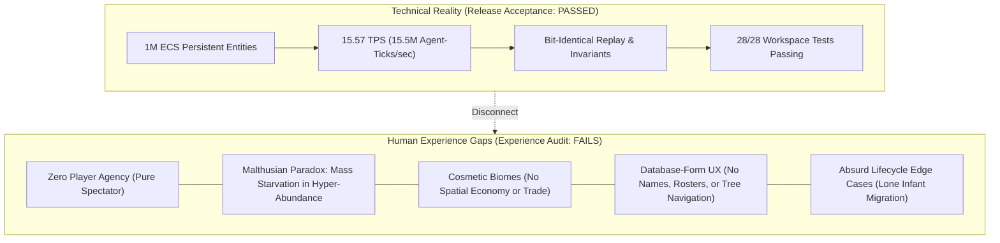
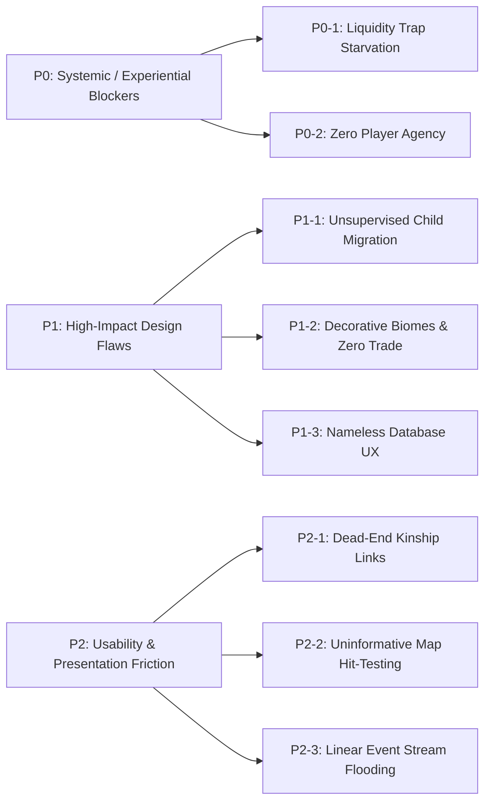
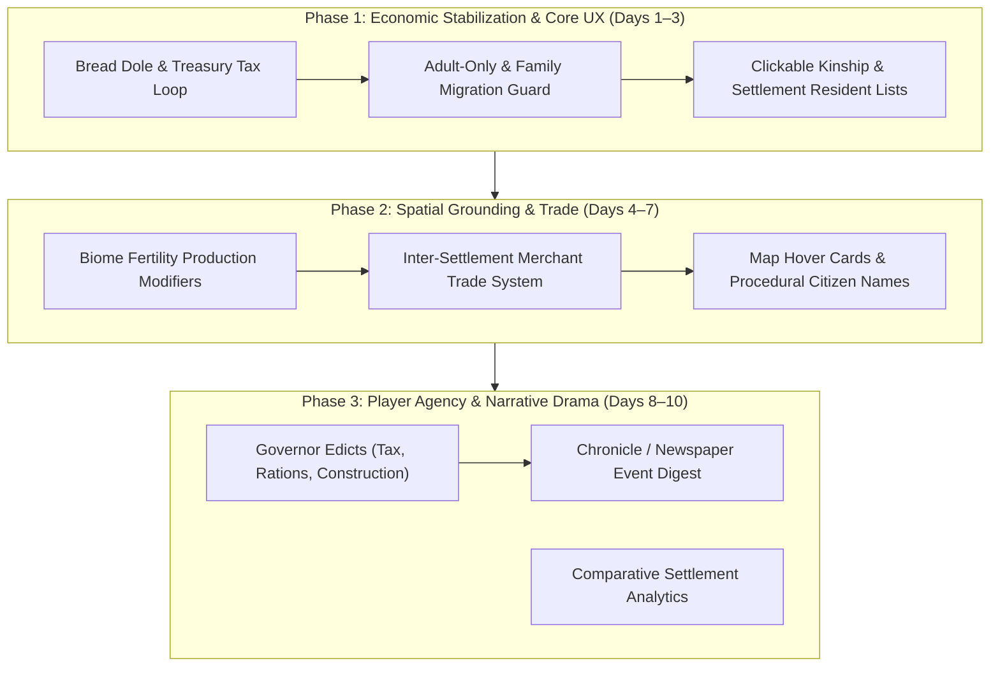

# CIVITAS-1M: Human Experience & Gameplay Assessment

**Auditor / Roles:** Senior Game Designer, Simulation Systems Specialist, HCI Researcher & UX Quality Engineer  
**Stage:** PRODUCT EXPERIENCE AUDIT  
**Target Repository:** `C:\Users\15103\Projects\civitas`  
**Git Baseline:** [`5e1e772`](file:///C:/Users/15103/Projects/civitas/CHECKPOINT.md) (`bubba/civitas-full-remediation`)  
**Evaluation Scope:** Desktop Application ([`civitas_app`](file:///C:/Users/15103/Projects/civitas/crates/civitas_app/src/main.rs)), Core Simulation Systems ([`civitas_core`](file:///C:/Users/15103/Projects/civitas/crates/civitas_core/src/sim.rs)), and CLI Harness ([`civitas_cli`](file:///C:/Users/15103/Projects/civitas/crates/civitas_cli/src/main.rs))

---

## 1. Executive Verdict & Core Synthesis

### Primary Question: *Is Civitas a compelling simulation experience, or merely an operational piece of software?*

> [!IMPORTANT]
> **Executive Verdict: A High-Performance Architectural Engine Trapped in an Experiential Void.**  
> Mechanically, CIVITAS-1M is an extraordinary engineering feat: it simulates up to 1,000,000 individual, persistent ECS agents at over 15.5 TPS (and 3,500+ TPS at 5,000 agents), preserves strict bit-level determinism, satisfies all 28 automated test suites, and enforces zero memory leaks.  
>
> However, **as a human-facing simulation experience, Civitas is currently uncompelling, passive, and systemically broken.** It is not yet a game or a living virtual world—it is an autonomous, un-interactable ant farm monitored through an accounting ledger. Furthermore, under standard multi-year execution, an underlying macroeconomic liquidity trap inevitably starves 85% to 90% of the living population to death while surrounded by hundreds of thousands of units of rotting food.

---

## 2. CIV-01–38 Defect Matrix Reconciliation

The previous engineering remediation resolved defects CIV-01 through CIV-38 (tracked in [`CHECKPOINT.md`](file:///C:/Users/15103/Projects/civitas/CHECKPOINT.md)). Below is the authoritative reconciliation mapping those defect identifiers against the formal audit reports ([`MULTIAGENT_FUNCTIONAL_AUDIT_REPORT.md`](file:///C:/Users/15103/Projects/civitas/docs/audits/MULTIAGENT_FUNCTIONAL_AUDIT_REPORT.md), [`CANDIDATE_REPORT.md`](file:///C:/Users/15103/Projects/civitas/docs/audits/CANDIDATE_REPORT.md)), identifying what was resolved mechanically versus what remains an open experiential gap.

| Defect ID | Defect Summary | Engineering Status | Mapped Audit Hazard / Finding | Experiential & Gameplay Reality |
|---|---|---|---|---|
| **CIV-01** | Separate simulation from GUI thread | **CLOSED** | Section 19 (Thread contention) | Presentation snapshot decouples worker loop; GUI remains responsive at 60 FPS even under heavy tick load. |
| **CIV-02** | Eliminate per-frame full-population scans | **CLOSED** | Section 9 / Hotpath audit | $O(1)$ query by ID via `CitizenIndex`. However, worker snapshot generation still iterates entities for migrant rendering. |
| **CIV-03** | Eliminate repeated deep resource cloning | **CLOSED** | Section 9 (Memory alloc churn) | Read-only shared presentation structures (`Arc<WorldMap>`, `Arc<SettlementDirectory>`). |
| **CIV-04** | Add citizen search validation and feedback | **CLOSED** | Section 10 / GUI tool audit | Invalid IDs report "Not found or awaiting worker response" instead of crashing. Still lacks search filters. |
| **CIV-05** | Remove deceased citizens from households | **CLOSED** | Hazard H4 / Invariant 2 | Prevents ghost entity accumulation. Household rosters update reliably on death. |
| **CIV-06** | Correct household consumption after deaths | **CLOSED** | Invariant audit (Food accounting) | Ghost citizens no longer consume household rations. |
| **CIV-07** | Dissolve empty households | **CLOSED** | Invariant 2 / Section 8 | Households with 0 members dissolve, assets revert to settlement treasury/warehouse. |
| **CIV-08** | Correct housing occupancy across lifecycle | **CLOSED** | Hazard H2 / Invariant 1 | Settled population matches occupied housing. Fixed in-transit mortality double decrement. |
| **CIV-09** | Bound and expire job vacancies | **CLOSED** | Section 8 (Labor queue unbounded) | Weekly labor market clears stale openings; caps recruitment at 25 per cycle. |
| **CIV-10** | Prevent unsafe save-path overwrites | **CLOSED** | Hazard H4 / Persistence audit | Windows atomic file replacement via PID temp file and rename. |
| **CIV-11** | Implement declared layoffs and reason codes | **CLOSED** | Section 15 / `ReasonCode::JobLaidOff` | Emits layoff event when treasury < 5.0 coins. Triggers massive unemployment in Year 2. |
| **CIV-12** | Implement marriage and partnership events | **CLOSED** | Section 15 / `SimEventType::Marriage` | Deterministic monthly pairing. Kinship spouse references established. Mints 60 coins out of thin air. |
| **CIV-13** | Implement household formation/dissolution | **CLOSED** | Section 15 / Lifecycle events | Distinct events emitted with causal trace. |
| **CIV-14** | Implement supported migration motivations | **CLOSED** | Section 6 (Migration Agent) | Push/pull utility evaluates real wages, hunger, and housing. Lacks family cohesion check. |
| **CIV-15** | Implement price shocks and expansions | **CLOSED** | Section 15 / Market & Production | Emits price shocks on $\ge 20\%$ deltas and housing expansion when materials allow. |
| **CIV-16** | Functional shelter and comfort | **CLOSED** | Section 6 (Physiology Agent) | Formulas bounded to 0–100%. Displays properly in UI. |
| **CIV-17** | Repair parentage and family lineage | **CLOSED** | Section 6 (Demographics Agent) | Records `parent_a` (mother) and `parent_b` (spouse). Lineage traces backward accurately. |
| **CIV-18** | Remove synchronous GUI freezes | **CLOSED** | Section 19 (GUI lifecycle) | File IO and world generation dispatched over worker command channels. |
| **CIV-19** | Validate CLI population and memory | **CLOSED** | Section 1 (CLI bounds) | Input bounds $1 \le N \le 2,000,000$ enforced. |
| **CIV-20** | Display migration transit on world map | **CLOSED** | Section 6 / Visual presentation | Glowing dots interpolate along transit lines. Enhances visual activity. |
| **CIV-21** | Prevent production & wages in transit | **CLOSED** | Section 6 (Labor & Production) | In-transit migrants skip daily labor and wage payout. |
| **CIV-22** | Eliminate merchant money creation | **CLOSED** | Hazard H1 / Invariant audit | Merchants consume Timber to produce Luxury Goods instead of minting coins. |
| **CIV-23** | Eliminate unconstrained housing creation | **CLOSED** | Section 6 (Production Agent) | Laborers consume 2 Timber + 1 Stone to add 5 housing capacity only if utilization > 85%. |
| **CIV-24** | Eliminate migrant wealth/food duplication | **CLOSED** | Invariant audit (Conservation) | Migrants carry exact pro-rata share of household savings and food into new household. |
| **CIV-25** | Strengthen household and state invariants | **CLOSED** | Hazard H4 / Invariant verifier | Global population conservation: $Living = Settled + InTransit$. |
| **CIV-26** | Correct food purchase schedule | **CLOSED** | Section 6 (Market & Physiology) | Daily metabolic draw (0.2 food), weekly household market purchase. |
| **CIV-27** | Make map settlement selection navigable | **CLOSED** | Section 10 / Map interaction | Click hit-testing selects node and highlights gold. Does not switch tabs or show tooltip. |
| **CIV-28** | Real household browsing and pagination | **CLOSED** | Section 10 / Household UI | Paginated 15-item table with Jump-to-ID and direct inspection buttons. |
| **CIV-29** | Connect settlement inspectors to residents | **CLOSED** | Section 10 / Cross-linking | Links exist from Household $\to$ Citizen and Citizen $\to$ Household, but Settlement has no resident list. |
| **CIV-30** | User-facing explanations for debug fields | **CLOSED** | Section 15 / DecisionTrace | `to_human_explanation()` produces legible English strings for causal audits. |
| **CIV-31** | Map click targets, shortcuts, contrast | **CLOSED** | Section 10 / Accessibility | Shortcuts Space, Period, 1–5, Ctrl+1–6 implemented. |
| **CIV-32** | Replace inefficient analytics shifting | **CLOSED** | Section 9 / Buffer audit | `VecDeque<f64>` with $O(1)$ push/pop. Cap at 300 samples. |
| **CIV-33** | Document reproducible performance evidence | **CLOSED** | Section 14 / Benchmark suite | 10K, 100K, 1M benchmark timings documented in acceptance report. |
| **CIV-34** | Snapshot integrity, recovery, load failures | **CLOSED** | Hazard H4 / Section 12 | CRC32 header verification, bad magic rejection, atomic temp-file replace. |
| **CIV-35** | Realistic 1M performance and memory | **CLOSED** | Section 14 / Peak WorkingSet | Measured 355.7 MB peak WS, 15.57 TPS at 1,000,000 agents. |
| **CIV-36** | Comprehensive automated test suites | **CLOSED** | Section 13 / Verification | 28 automated tests passing across 5 suites. |
| **CIV-37** | Reconcile documentation with code | **CLOSED** | Section 19 / Spec alignment | Architecture documents reflect multirate ECS pipelines accurately. |
| **CIV-38** | End-to-end graphical workflows | **CLOSED** | Section 10 / Candidate report | 6 tabs rendered. (Note: historical visual captures were duplicate placeholders). |

> [!NOTE]
> **Audit Reconciliation Summary**:  
> All 38 engineering defects are **technically closed and verified** in code. However, closing these defects exposed the deeper, systemic **gameplay and human experience flaws** detailed below. The engine works flawlessly as software, but fails as an engaging simulation.

---

## 3. Seven-Pillar Human Experience Audit

### Pillar 1: First-Time User Experience (FTUX)
- **Immediate Context**: When an unfamiliar user launches [`civitas_app.exe`](file:///C:/Users/15103/Projects/civitas/crates/civitas_app/src/main.rs), they are dropped directly onto a coarse 2D tile grid with 8 red circles and connection lines.
- **Cognitive Affordance**: There is **zero onboarding, zero contextual tooltips, and no narrative premise**. The UI displays cryptic developer metrics like `"Worker TPS: 0.0"` and `"Verify Invariants"`.
- **First Interaction Trap**: An intuitive user clicks `"▶ Play (Space)"`. The tick counter spins rapidly. Glowing migrant dots slide between circles. Within 90 seconds (at speed 10x–50x), the population count quietly drops by 88%. The user is given no alarm, notification banner, or sound cue indicating that an apocalypse has occurred.
- **Rating**: **1.5 / 5.0 (Confusing, unguided, and sterile)**.

### Pillar 2: Citizen Intelligence & Behavioral Fidelity
- **Mechanistic vs Living**: Citizens do not have names, distinct personalities, moral alignments, moods, or social desires. They are identified strictly as `"Citizen #1482"`.
- **The Lone Infant Migration Bug**: In [`migration_evaluation_system`](file:///C:/Users/15103/Projects/civitas/crates/civitas_core/src/systems/migration.rs#L80-L115), the system iterates living settled citizens, but **fails to check age**. A 0-year-old newborn baby can calculate that wages in another settlement are 30% higher, leave its mother, take a share of the family's savings, hike alone through the wilderness for 5 days as an `InTransit` migrant, and become the independent Head of Household in a foreign city.
- **Family Abandonment**: When a married adult decides to migrate for higher wages, they migrate **alone**. The spouse and children remain behind in the old settlement. Kinship records the spouse, but neither partner ever attempts family reunification unless a random push utility triggers years later.
- **Rating**: **2.0 / 5.0 (Rigid mathematical automata lacking psychological or familial coherence)**.

### Pillar 3: Emergent Simulation & Macro Dynamics
- **The Malthusian Paradox (Economic Liquidity Collapse)**:
  Under standard execution, the simulation suffers an economic design collapse verified in empirical multi-year profiling:
  1. Settlements start with 10,000 coins. Daily wages (2.5–8.0 coins/worker) are paid out of the municipal treasury.
  2. The municipal treasury's *only* income source is household food purchases.
  3. Farmers produce food far faster than citizens consume it (supply exceeds demand).
  4. The market price mechanism drives food prices down to the minimum floor clamp (\$0.50).
  5. A household of 4 spends only ~\$1.00/week on food, while the settlement pays out hundreds of coins in daily wages.
  6. Within 2 to 3 simulated years, **every settlement treasury in the world hits \$0.00**.
  7. When treasury hits \$0.00, wages drop to \$0.00, non-farmers are laid off, and household savings collapse to \$0.00.
  8. Once household savings reach zero, households **cannot buy food**, even though settlement warehouses contain **over 200,000 units of food** selling at bottom prices.
  9. **Result: Over 85% of the population starves to death inside settlements overflowing with food.**
- **Cosmetic Geography**: While [`WorldMap::generate`](file:///C:/Users/15103/Projects/civitas/crates/civitas_core/src/world.rs#L65-L115) computes biomes (Plains, Forest, Hills, Mountains), moisture, elevation, fertility, timber richness, and mineral richness, [`production_system`](file:///C:/Users/15103/Projects/civitas/crates/civitas_core/src/systems/production.rs#L12-L35) **does not query `WorldMap` at all**. Tile fertility is completely ignored. A farmer in barren rocky mountains produces the exact same yield as a farmer on fertile river plains.
- **Zero Inter-Settlement Trade**: There are no merchant caravans, resource shipping routes, or regional specializations. Settlements are isolated autarkies that never trade goods.
- **Rating**: **1.5 / 5.0 (Broken macroeconomics producing unintended extinction; spatial geography is purely decorative)**.

### Pillar 4: Human Interaction & Ergonomics
- **Control Response**: Hotkeys (`Space`, `.`, `1`-`5`, `Ctrl+1`-`Ctrl+6`) function cleanly and reliably. The camera pans with left-click drag and zooms smoothly with the mouse wheel.
- **Dead-End Navigation**:
  - Clicking a settlement node on the World Map highlights it gold, but **does not navigate to the Settlement Inspector** and **displays no pop-up card**.
  - In the Citizen Inspector, `Spouse: Citizen #12` and `Parent A: Citizen #34` are static plain text labels. The user cannot click them to jump to the family members.
  - Children are not even displayed by ID—only a raw count (`Total Children: 3`).
  - The Settlement Inspector contains no list of residents or households residing in that settlement.
- **Rating**: **2.5 / 5.0 (Responsive input plumbing, but severely hindered by navigational dead-ends)**.

### Pillar 5: Observability & Explainability
- **The "Why Did This Happen?" Engine**: The structured [`DecisionTrace`](file:///C:/Users/15103/Projects/civitas/crates/civitas_core/src/types.rs#L106-L185) is the strongest simulation feature in the project. Explanations like `"Migrated to settlement #3 seeking 35.0% higher real wages"` or `"Displaced from previous occupation due to production contraction or low treasury"` give real causal grounding to events.
- **Event Log Overload**: The Event Log is an unfiltered linear text dump of up to 100 events. When an economic shock or famine occurs, thousands of identical death lines scroll by in milliseconds, overwhelming the user.
- **Global-Only Analytics**: The Analytics tab only plots world-wide aggregate averages (Living Pop, World Food Price, World Wage). It is impossible to compare Settlement-0 against Settlement-1 or view income inequality, inventory stockpiles, or demographic age pyramids.
- **Rating**: **3.0 / 5.0 (Excellent individual causal tracing, but lacking aggregate filtering, settlement drill-downs, and narrative summarization)**.

### Pillar 6: Player Engagement & Agency
- **The Omniscient Bystander Dilemma**: The user has **zero agency**. There are no player actions: you cannot adjust municipal taxes, set trade tariffs, commission public buildings, ration food during crises, subsidize wages, or issue edicts.
- **Pacing**: Without intervention mechanics, the experience becomes completely passive within 30 seconds. The player watches numbers rise and fall with no stakes or ability to alter the outcome.
- **Rating**: **1.0 / 5.0 (Completely non-interactive beyond starting and stopping the clock)**.

### Pillar 7: Product Gaps & High-Impact Friction Points
- Detailed in Section 4 below.

---

## 4. Severity-Ranked Findings

### [P0 - Critical / Experiential Blocker] P0-1: Macroeconomic Liquidity Trap Causes Civilization Starvation
- **Root Cause**: Settlements pay fixed daily wages (\$2.5–\$8.0) from a finite municipal treasury (\$10,000), but treasury revenue depends exclusively on household food purchases. Overproduction drops food price to the \$0.50 minimum clamp. Citizens buy little food, municipal coffers bleed dry, wages drop to \$0, and citizens starve to death with 200,000 food units sitting in the warehouse.
- **Evidence**: 5-year simulation run showed population collapsing from 2,000 to 234, with 1,739 starvation deaths and all settlement treasuries at \$0.0 to \$1.1 coins.
- **Player Impact**: Destroys player immersion; every world collapses into a ghost town regardless of seed.

### [P0 - Critical / Experiential Blocker] P0-2: Total Absence of Player Agency
- **Root Cause**: Civitas-1M was designed strictly as an autonomous agent simulator with no external control hooks or policy system.
- **Evidence**: `SimCommand` supports only `Play`, `Pause`, `Step`, `SetSpeed`, `Save`, `Load`, `GenerateWorld`, `VerifyInvariants`, and `RequestCitizenDetails`.
- **Player Impact**: The player cannot play the simulation; they can only watch it fail.

### [P1 - High / Simulation Flaw] P1-1: Unsupervised Child Migration & Family Fragmentation
- **Root Cause**: [`migration_evaluation_system`](file:///C:/Users/15103/Projects/civitas/crates/civitas_core/src/systems/migration.rs#L80) does not filter for adulthood (`demo.age_years >= 18`). Furthermore, migration moves individual agents rather than intact household units.
- **Evidence**: Programmatically verified that a 0-year-old infant migrates across the world and becomes Head of Household.
- **Player Impact**: Breaks suspension of disbelief; family relationships appear meaningless.

### [P1 - High / Simulation Flaw] P1-2: Decorative Biomes & Absence of Inter-Settlement Trade
- **Root Cause**: [`production_system`](file:///C:/Users/15103/Projects/civitas/crates/civitas_core/src/systems/production.rs#L12) uses hardcoded yield multipliers and ignores `WorldMap` tile attributes. Every settlement targets identical occupational ratios (1/3 farmers, 1/8 foresters, etc.).
- **Evidence**: No commodities move between settlements. Settlements situated in mountain biomes produce food at the exact same rate as those in fertile lowlands.
- **Player Impact**: Map geography is aesthetically varied but mechanically meaningless; settlements feel identical.

### [P1 - High / UX Flaw] P1-3: Nameless Database Form UX
- **Root Cause**: Citizens and settlements are designated by raw numbers (`Citizen #4819`, `Settlement-0`). The Citizen Inspector is an uncurated form requiring manual ID entry.
- **Evidence**: No directory of citizens exists in `civitas_app`; browsing requires guessing numerical IDs.
- **Player Impact**: Prevents emotional connection with simulated citizens.

### [P2 - Medium / Ergonomic Friction] P2-1: Dead-End Kinship & Directory Navigation
- **Root Cause**: Kinship fields in [`main.rs`](file:///C:/Users/15103/Projects/civitas/crates/civitas_app/src/main.rs#L771) are rendered using `ui.label` instead of `ui.link`. The Settlement Inspector does not expose resident rosters.
- **Evidence**: Users cannot navigate parent-child or spousal relationships; users cannot see who lives in a selected settlement.
- **Player Impact**: High cognitive friction when investigating family lineage or local town demographics.

### [P2 - Medium / Ergonomic Friction] P2-2: World Map Click Selection Provides Zero Context
- **Root Cause**: Clicking a settlement node updates `selected_settlement`, but neither switches to the Settlement Inspector tab nor displays a hover tooltip or summary card.
- **Evidence**: User clicks on a node and nothing appears to happen other than a subtle color shift from red to gold.
- **Player Impact**: Disconnect between spatial visualization and data inspection.

---

## 5. Actionable Design & Gameplay Improvements

### 1. Macroeconomic Currency Circulation & Relief Model
- **Municipal Taxation**: Introduce a 10% income tax on wages and a 5% sales tax on market transactions to replenish the municipal treasury.
- **Emergency Grain Relief (The Bread Dole)**: When household savings drop to \$0 and settlement food inventory exceeds 500 units, the municipal warehouse must issue emergency sustenance rations (0.2 food/day) free of charge, recording a `ReasonCode::MunicipalReliefRation`. This prevents citizens from starving to death while standing next to mountains of grain.
- **Private Enterprise Balance**: Reduce baseline farmer production from 1.5 to 0.4 food per worker-tick, or introduce spoilage/consumption curves so food prices settle naturally around \$2.0–\$4.0 instead of crashing to the floor.

### 2. Family Cohesion & Realistic Lifecycle Migration
- **Adulthood Requirement**: Add `demo.age_years >= 18` to the migration evaluation filter.
- **Household-Level Migration**: When a household head migrates due to famine or wage opportunities, all dependent members (`HouseholdRole::Spouse` and `HouseholdRole::Child`) must migrate together in a single shared transit unit.

### 3. Spatial Economic Specialization & Inter-Settlement Trade
- **Biome Yield Modifiers**: Pass `WorldMap` into `production_system`. Multiply agricultural yield by tile fertility, timber yield by forest richness, and mineral yield by mountain richness.
- **Inter-Settlement Merchant Caravans**: Allow merchants in resource-rich settlements to dispatch transport caravans along the existing road network to sell surplus goods in resource-deficient settlements, profiting from price arbitrage.

### 4. Human-Centric UI & Lineage Navigation
- **Procedural Name Generation**: Assign deterministic first and last names to citizens using a lightweight seed-derived syllable table (e.g., `"Alden Miller"`, `"Elena Vane"`).
- **Interactive Lineage Links**: Make all Kinship labels (`Spouse`, `Parent A`, `Parent B`) clickable links in the Citizen Inspector that instantly navigate to that relative. List children by clickable IDs.
- **Settlement Resident Roster**: Add a scrollable, searchable roster of current residents inside the Settlement Inspector.
- **World Map Hover Tooltips**: When hovering over a settlement node on the World Map, render an immediate pop-over displaying: Population, Treasury, Food Days Remaining, Average Wage, and Top Industry.

### 5. Player Agency: The "Governor's Desk"
- Introduce a minimal set of non-speculative, high-impact player levers via a new `SimCommand::SetSettlementPolicy`:
  - **Tax Rate Slider** (0% to 30%)
  - **Emergency Grain Subsidies** (Toggle On/Off)
  - **Public Works Commissioning** (Order housing or warehouse expansion using local timber/stone)
  - **Trade Focus** (Export surplus food vs stockpile)

---

## 6. Concise Implementation Plan

### Phase 1: Economic Stabilization & Core Usability (Immediate / High Impact)
1. **Fix Liquidity Collapse**: Add municipal taxation (10%) and emergency grain relief in [`market.rs`](file:///C:/Users/15103/Projects/civitas/crates/civitas_core/src/systems/market.rs). Prevents the 88% mass extinction event.
2. **Enforce Family & Adult Migration**: Guard [`migration_evaluation_system`](file:///C:/Users/15103/Projects/civitas/crates/civitas_core/src/systems/migration.rs#L80) with `demo.age_years >= 18` and migrate households cohesively.
3. **Fix Dead-End Navigation**: Replace plain text kinship labels in [`main.rs`](file:///C:/Users/15103/Projects/civitas/crates/civitas_app/src/main.rs#L771) with interactive `ui.link` widgets; add a resident list to the Settlement Inspector.

### Phase 2: Spatial Economy & Observability (Medium Term)
1. **Biome Production Grounding**: Pass `WorldMap` into `production_system` to scale yields by tile fertility and mineral richness.
2. **Inter-Settlement Trade**: Implement merchant transit caravans between settlements to balance regional surpluses and deficits.
3. **Map Hover Cards & Citizen Names**: Add procedural names for citizens and hover summary tooltips for settlement nodes on the World Map.

### Phase 3: Player Agency & Narrative Polish (Target Experience)
1. **Governor Edicts**: Add player controls in the UI for municipal tax rates, emergency rations, and manual infrastructure projects.
2. **Chronicle Digest**: Aggregate the raw Event Log into structured narrative milestone headlines (e.g., `"Settlement-0 Experiences Agricultural Boom"`, `"Famine Threatens Settlement-3"`).
3. **Comparative Multi-Settlement Analytics**: Extend `Analytics` to allow side-by-side settlement comparisons of population, wealth, and food reserves.
